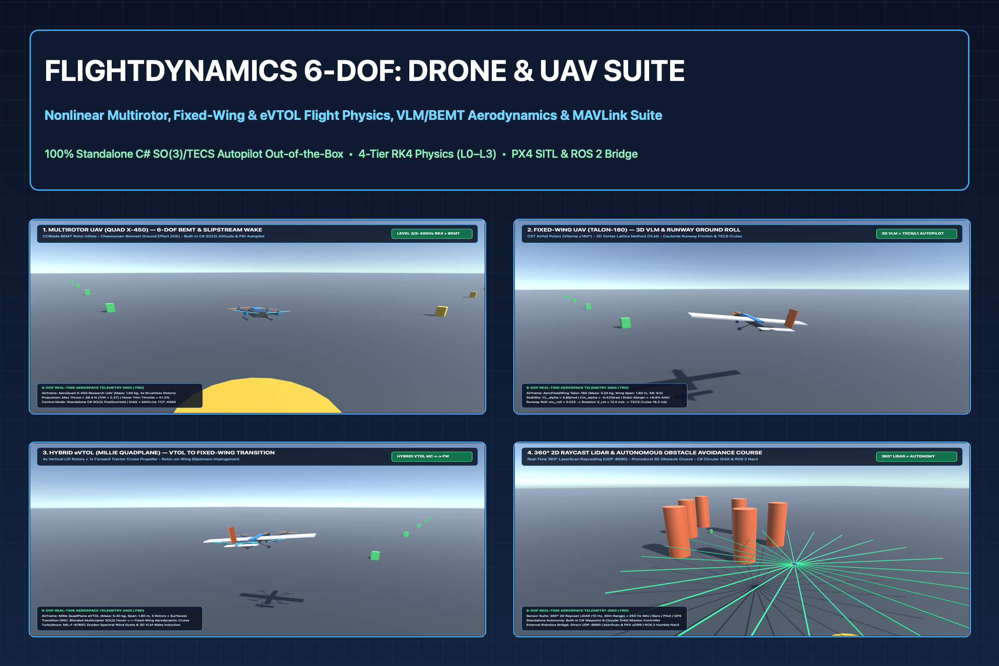
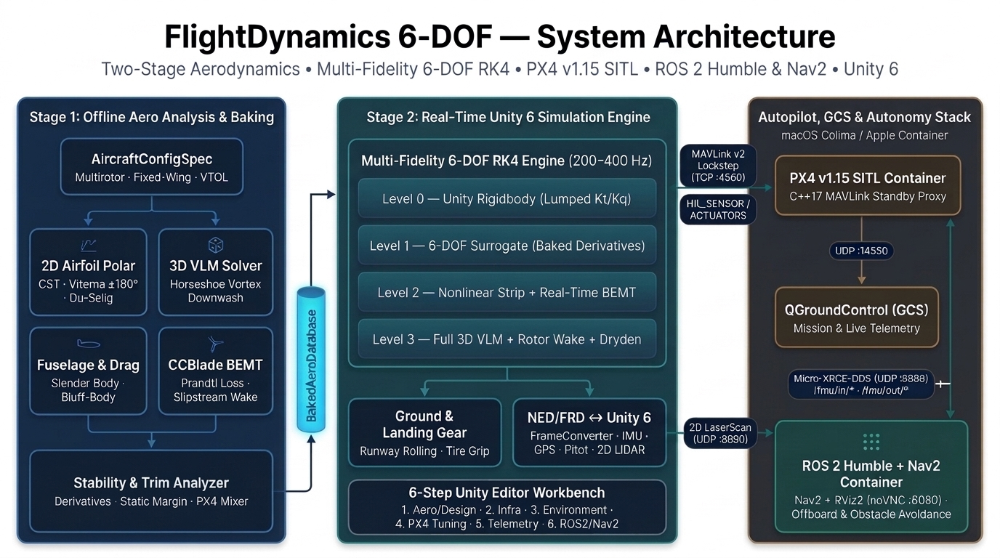
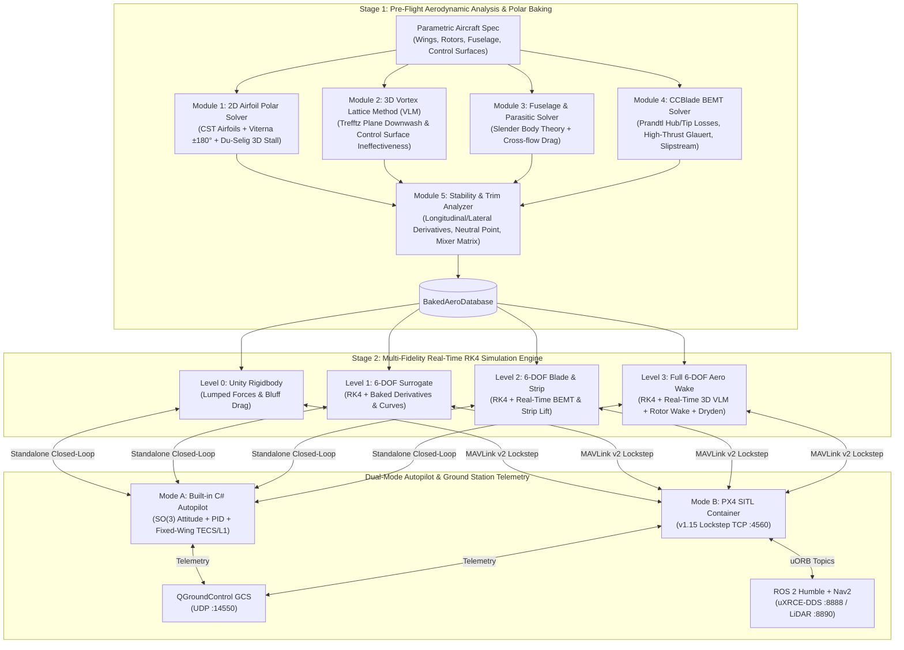
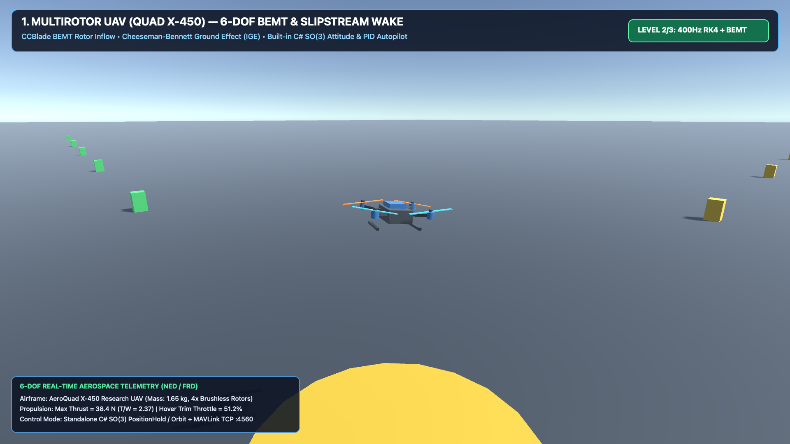
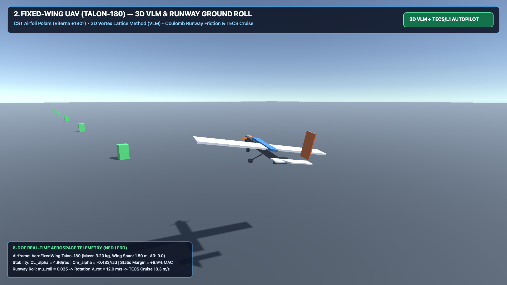
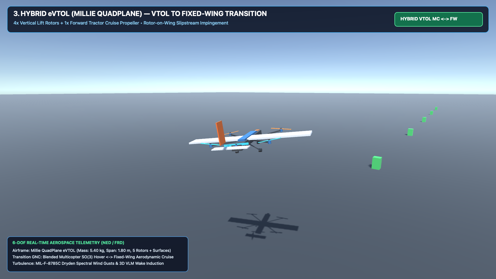
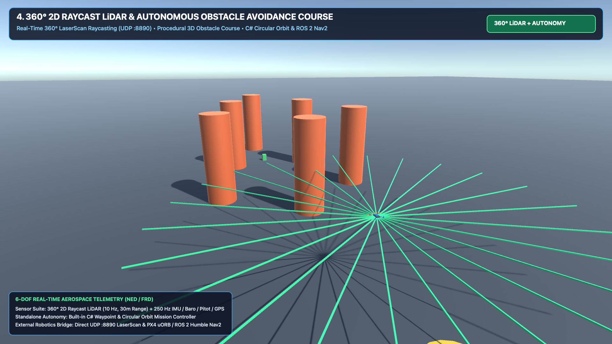

# FlightDynamics 6-DOF: Drone & UAV Suite

[](LICENSE)
[](https://unity.com/)
[](https://dotnet.microsoft.com/)
[](https://px4.io/)
[](https://www.ros.org/)
[](dotnet/FlightDynamics6DoF.Tests/)

**FlightDynamics 6-DOF: Drone & UAV Suite** is an engineering-grade aerospace flight dynamics, aerodynamic analysis, and autonomous GNC (Guidance, Navigation, and Control) simulation suite for Unity. Designed for UAV researchers, aerospace engineers, robotics developers, and high-fidelity flight simulator creators, it combines a 5-module offline aerodynamic solver pipeline (CST parametric airfoils, 3D Vortex Lattice Method, and CCBlade BEMT) with a 400 Hz multi-fidelity 6-DOF RK4 physics engine, a **100% standalone built-in C# SO(3)/TECS autopilot**, and a zero-dependency **MAVLink v2 / PX4 SITL / ROS 2 bridge**.



---

## Dual-Mode Execution Architecture

FlightDynamics 6-DOF operates seamlessly across two execution modes:

| Execution Mode | Target Environment | Requirements | Capabilities |
| :--- | :--- | :--- | :--- |
| **Mode A: Standalone Built-in C# Autopilot** *(Default Out-of-the-Box)* | **Windows, macOS, Linux** (Unity Asset Store & Standalone Projects) | **Zero external tools** (Pure Unity + `.NET Standard 2.1`) | Built-in `CascadedFlightController` performs Multirotor SO(3) attitude & PID position hold, autonomous circular orbit, RTL, Auto-Land, Fixed-Wing 3-phase runway takeoff roll & TECS/L1 cruise, and Hybrid QuadPlane VTOL transition flight out-of-the-box. |
| **Mode B: External PX4 SITL, QGC & ROS 2 Bridge** *(Optional)* | **macOS / Linux / WSL2** Hardware & Software-in-the-Loop (HIL/SITL) | External PX4 SITL (`TCP :4560`) or companion Colima / Apple `container` stack | Zero-dependency MAVLink v2 lockstep (`HIL_SENSOR`, `HIL_GPS`, `HIL_ACTUATOR_CONTROLS`), simultaneous QGroundControl telemetry (`UDP :14550`), Micro-XRCE-DDS (`UDP :8888`), and 360° 2D Raycast LiDAR (`UDP :8890`) for ROS 2 Humble + Nav2 obstacle avoidance. |

---

## Key Features

- **Two-Stage Aerodynamic & Stability Analysis Pipeline (Stage 1)**:
  - **Module 1 (2D Airfoil Polar Solver)**: CST parametric airfoils, viscous boundary-layer approximation, Viterna $\pm 180^\circ$ post-stall extrapolation, and Du-Selig 3D rotational stall delay.
  - **Module 2 (3D Vortex Lattice Method — VLM)**: Horseshoe vortex downwash, finite-wing induced drag, and high-alpha control surface effectiveness decay.
  - **Module 3 (Fuselage & Parasitic Solver)**: Slender-body theory and cross-flow bluff-body drag integration.
  - **Module 4 (CCBlade BEMT Rotor Solver)**: Blade Element Momentum Theory with Prandtl hub/tip loss, Glauert high-thrust correction, Cheeseman-Bennett ground effect (IGE), and contracting slipstream wake tubes.
  - **Module 5 (Stability & Trim Analyzer)**: Automated calculation of longitudinal/lateral-directional derivatives ($C_{L\alpha}, C_{m\alpha}, C_{n\beta}, C_{lp}, C_{mq}, C_{nr}$), Neutral Point ($x_{\text{NP}}$), Static Margin (% MAC), trim condition, and pseudoinverse actuator mixer matrix.
- **Multi-Fidelity Real-Time 6-DOF Physics Engine (Stage 2: Levels 0..3)**:
  - **Level 0 (Unity Rigidbody)**: Lumped $K_t / K_q$ rotor thrust/torque and bluff-body drag coupled directly to Unity `Rigidbody`.
  - **Level 1 (6-DOF Surrogate)**: 400 Hz RK4 integration in exact Aerospace NED/FRD coordinates using pre-baked stability derivatives and surrogate BEMT curves.
  - **Level 2 (6-DOF Blade & Strip)**: Real-time nonlinear lifting-line strip theory with blade-element rotor inflow dynamics.
  - **Level 3 (Full 6-DOF Aero Wake)**: Real-time 3D VLM panel solver, rotor-on-wing slipstream impingement, blade flapping, and MIL-F-8785C Dryden atmospheric turbulence.
- **Runway Ground Dynamics & Landing Gear Mechanics**:
  - Coulomb rolling friction ($\mu_{\text{roll}} \approx 0.025$) for realistic fixed-wing runway acceleration.
  - Lateral tire cornering stiffness, nose-gear rotation freedom ($V_{\text{rot}}$), automatic idle parking brake, and surface boundary-layer gust attenuation.
- **Unified 6-Step Editor Engineering Workbench**:
  - Custom Editor window (`Tools > FlightDynamics 6-DOF > Unified 5-Step Engineering Workbench`) with 6 modular tabs:
    1. **`1. Aero/Design`**: Airframe preset loader, 3D mesh inertia extractor, interactive 2D Airfoil & Rotor BEMT calculators, and Stage-1 aerodynamic baking.
    2. **`2. Infra`**: Standalone C# Autopilot status overview and optional 1-click Colima / Apple container orchestration (`SitlInfraController`).
    3. **`3. Environment`**: 1-click 3D demo scene builder, fidelity tier selector (`L0`–`L3`), and atmospheric wind/turbulence controls.
    4. **`4. PX4 Tuning`**: Per-airframe GNC/PX4 control parameter table sliders, live flight commands, and `.params` exporter.
    5. **`5. Telemetry`**: Real-time multi-channel vector plots, automated RMSE metrics, retention policy manager, and 1-click **CSV & Interactive HTML5/SVG Academic Report** export (`Assets/FlightLogs/`).
    6. **`6. ROS2/Nav2`**: 360° 2D Raycast LiDAR (`Ros2LidarAndObstacleCourse`, `UDP :8890`), 3D obstacle course generator, autonomous circular orbit controller, and ROS 2 Humble / Nav2 RViz2 (`noVNC :6080`) launcher.
- **Clean-Room Engineering & Permissive Licensing**:
  - 100% free of GPL/LGPL contamination. Pure Apache 2.0 license with full C# Unity Runtime/Editor source and pre-compiled `.NET Standard 2.1` core physics assembly (`FlightDynamics6DoF.Core.dll` + XML IntelliSense documentation).

---

## System Architecture



<details>
<summary>View Mermaid Architecture Diagram</summary>



</details>

---

## Supported Vehicle Configurations

| Vehicle Category | Preset Name / PX4 Flag | Mass (kg) | Wingspan | Propulsion Setup | Takeoff & Flight Mode | Actuator Mapping |
| :--- | :--- | :---: | :---: | :--- | :--- | :--- |
| **Multirotor (Quad X)** | `AeroQuad X-450` (`iris`) | 1.65 kg | 0.45 m diag | 4× Brushless Motors (Quad X) | Vertical VTOL, Hover & Circular Orbit | Ch 1..4: Lift Motors |
| **Fixed-Wing UAV** | `AeroFixedWing Talon-180` (`plane`) | 3.20 kg | 1.80 m | 1× Forward Tractor Propeller + Aileron/Elev/Rud | Runway Ground Roll, Rotation & TECS Cruise | Ch 5: Throttle, Ch 6..8: Ail/Elev/Rud |
| **Hybrid QuadPlane eVTOL** | `Millie QuadPlane VTOL` (`standard_vtol`) | 5.40 kg | 1.80 m | 4× VTOL Lift Rotors + 1× Cruise Propeller + Surfaces | Vertical Takeoff $\leftrightarrow$ Fixed-Wing Transition | Ch 1..4: VTOL, Ch 5: Cruise Prop, Ch 6..8: Surfaces |

| Multirotor (`Quad X-450`) | Fixed-Wing (`Talon-180`) |
| :---: | :---: |
|  |  |
| **Hybrid QuadPlane eVTOL (`Millie VTOL`)** | **360° 2D Raycast LiDAR & Obstacle Course** |
|  |  |

---

## Quickstart Guide

### Option 1: Install as Unity Asset Store Package (`.unitypackage`) or UPM Tarball (`.tgz`)
1. Import `build/FlightDynamics6DoF_AssetStore_v1.0.0.unitypackage` (`Assets > Import Package > Custom Package...`) or install `build/com.aerospace.flightdynamics6dof-1.0.0.tgz` via Unity Package Manager (`+ > Add package from tarball...`).
2. Open `Assets/FlightDynamics6DoF/Demo/Scenes/FlightDynamics6DoF_EngineeringDemo.unity` (or click **`Tools > FlightDynamics 6-DOF > Quick-Build 3D Demo Scene Now`**) and press **Play**.
3. The simulation starts immediately in **Standalone Built-in C# Autopilot Mode** with zero external software required:
   - Click **`Takeoff`**, **`Start Autonomous Circular Orbit (10m)`**, **`Loiter`**, **`RTL`**, or **`Land`** in the top-left Engineering HUD.
   - Switch live between **`Quad X-450`**, **`Fixed-Wing`**, and **`QuadPlane VTOL`** (click **`Takeoff`** on Fixed-Wing for runway ground-roll takeoff, or **`Transition to Fixed-Wing (FW)`** on QuadPlane VTOL).

### Option 2: Clone Full Engineering Repository (Core .NET Build + Optional PX4/ROS 2 SITL)

#### 1. Build Core Assembly, Run 240 Automated Tests & Package Archives
```bash
git clone https://github.com/jyhuh/Unity-FlightDynamics-6DoF.git
cd Unity-FlightDynamics-6DoF
./scripts/build-and-package.sh
```
This runs all **240 automated physics & GNC assertions**, compiles the protected `.NET Standard 2.1` `FlightDynamics6DoF.Core.dll`, verifies Unity 6 Runtime/Editor script compilation, and outputs `.unitypackage` and `.tgz` distributions to `build/`.

#### 2. (Optional) Launch External PX4 SITL & ROS 2 Humble Containers
```bash
# Start PX4 v1.15 SITL + ROS 2 Micro-XRCE-DDS containers (e.g., iris, plane, or standard_vtol)
./scripts/px4-sitl.sh up iris

# Launch ROS 2 Nav2 + RViz2 autonomous obstacle avoidance (noVNC at http://localhost:6080/vnc.html)
./scripts/px4-sitl.sh ros2-nav2

# Stop containers or shutdown background Colima VM
./scripts/px4-sitl.sh down
./scripts/px4-sitl.sh vm-stop
```

---

## Technical Documentation Suite

Comprehensive engineering guides, mathematical derivations, and Unity Asset Store publishing materials are available in the [`docs/`](docs/) directory:

1. [**System Architecture & Multi-Fidelity Solvers**](docs/architecture.md) — Two-stage architecture, CST airfoil modeling, 3D VLM downwash, CCBlade BEMT, and fidelity level trade-offs.
2. [**Ground Contact, Runway Friction & Landing Gear Mechanics**](docs/ground-contact-model.md) — Coulomb rolling resistance, lateral tire grip, takeoff rotation dynamics ($V_{\text{rot}}$), and boundary-layer turbulence attenuation.
3. [**PX4-Autopilot SITL & Container Stack Setup (macOS)**](docs/px4-sitl-setup.md) — Colima containerd optimization, MAVLink lockstep over TCP, dynamic pressure airspeed streaming, and port routing.
4. [**Vehicle Configuration & Parameter Tuning**](docs/vehicle-configuration.md) — Vehicle geometry configuration, aerodynamic polar baking, and actuator channel fallback matrix.
5. [**ROS 2 Humble & Micro-XRCE-DDS Integration**](docs/ros2-integration.md) — DDS topic mapping, offboard trajectory streaming, Python autonomous orbit controller, and Nav2 + RViz2 (noVNC) obstacle avoidance.
6. [**Unity Asset Store Listing & Compliance Documentation**](docs/asset-store/AssetStore_Listing_KO_EN.md) — Official Asset Store metadata, descriptions (EN/KO), promotional images, and [Standalone vs. SITL compliance report](docs/asset-store/AssetStore_Compliance_Report.md).
7. [**Task & Roadmap Backlog**](docs/roadmap.md) — Feature backlog and verification checklist *(in Korean)*.

---

## Repository Structure

```text
Unity-FlightDynamics-6DoF/
├── .github/                       # GitHub Issue & Pull Request Templates
├── Assets/                        # Unity Project Assets & Engineering Demo Scene
├── docker/
│   ├── px4-sitl/                  # PX4 v1.15 SITL Containerfile & C++17 MAVLink Standby Proxy
│   └── ros2/                      # ROS 2 Humble, Micro-XRCE-DDS & Nav2 Obstacle Avoidance Nodes
├── docs/                          # Technical Documentation & Asset Store Publishing Materials
│   ├── asset-store/               # Unity Asset Store Listing (EN/KO), Compliance Report & 10 Promo Images
│   ├── images/                    # System Architecture Diagrams
│   ├── README.md                  # Documentation Index & Sitemap
│   ├── architecture.md            # Physics & Mathematical Architecture
│   ├── ground-contact-model.md    # Runway Friction & Rotation Dynamics
│   ├── px4-sitl-setup.md          # macOS Colima SITL Deployment Guide
│   ├── vehicle-configuration.md   # Vehicle Specs & Mixer Calibration
│   ├── ros2-integration.md        # ROS 2 Autonomy & uORB Topic Guide
│   └── roadmap.md                 # Feature Backlog & Verification Checklist
├── dotnet/
│   ├── FlightDynamics6DoF.Core/   # Pure C# .NET Standard 2.1 Core Physics, Aero, GNC & MAVLink Engine
│   └── FlightDynamics6DoF.Tests/  # 240 Automated Unit & Closed-Loop Dynamics Test Assertions
├── Packages/
│   └── com.aerospace.flightdynamics6dof/ # Unity Package (Runtime DLL, C# Components & 6-Step Editor Workbench)
├── scripts/
│   ├── build-and-package.sh       # Unified Build, 240-Test Verification & Asset Store / UPM Packaging Script
│   ├── package-asset-store.py     # Builds .unitypackage and .tgz distribution archives into build/
│   ├── px4-sitl.sh                # Container Lifecycle & Colima VM Manager
│   └── unity-cli.sh               # Live Unity Editor & Batchmode CLI Bridge
├── CONTRIBUTING.md                # Conventional Commits & Contribution Guidelines
├── CODE_OF_CONDUCT.md             # Contributor Covenant Code of Conduct
├── LICENSE                        # Apache License 2.0
├── NOTICE                         # Clean-Room Engineering Notice & Academic Attributions
└── README.md                      # Project Overview & Quickstart Guide
```

---

## Community & Contributing

We welcome contributions from aerospace engineers, simulation developers, and roboticists. Please review our guidelines before opening a pull request:
- [**Contributing Guidelines**](CONTRIBUTING.md) — Conventional Commits format, branch naming, and automated test requirements.
- [**Code of Conduct**](CODE_OF_CONDUCT.md) — Contributor Covenant v2.1 standards.
- [**Issue Tracker**](https://github.com/jyhuh/Unity-FlightDynamics-6DoF/issues) — File bug reports or submit feature requests using our templates.

---

## License & Intellectual Property

This project is licensed under the **Apache License, Version 2.0**. See the [LICENSE](LICENSE) file for complete terms.

For detailed attribution of underlying academic literature (AirfoilPrep, CCBlade, NeuralFoil, MachUpX, FLOWUnsteady) and clean-room engineering confirmation, see [NOTICE](NOTICE) and [ThirdPartyNotices.md](Packages/com.aerospace.flightdynamics6dof/ThirdPartyNotices.md).
