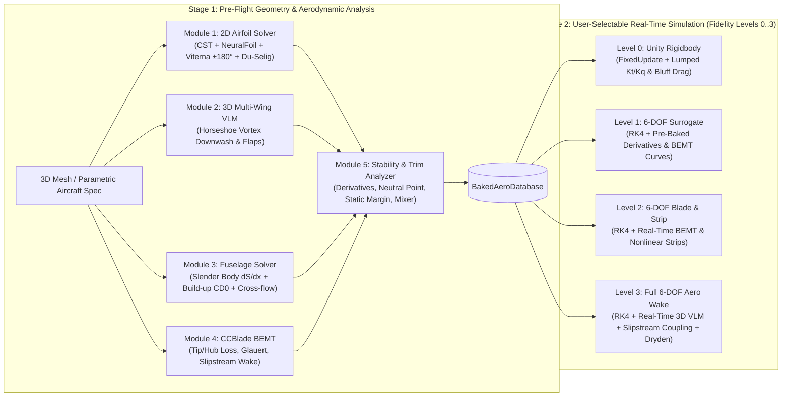

# FlightDynamics 6-DOF: Nonlinear UAV/VTOL FDM, Aerodynamic Analysis & MAVLink Engineering Suite

**Package ID:** `com.aerospace.flightdynamics6dof`  
**License:** Apache License 2.0 (100% free of GPL/LGPL dependencies)  
**Target Runtime:** C# `.NET Standard 2.1` (Protected Core DLL) + Unity 2021.3+ / Unity 6 (`6000.3.11f1`)

---

## 1. Overview & Two-Stage Architecture

`FlightDynamics 6-DOF` is a commercial-grade aerospace engineering and flight simulation suite for Unity, separating **Stage 1 (Pre-Simulation Geometry & Aerodynamic Analysis)** from **Stage 2 (Multi-Fidelity Real-Time 6-DOF Simulation)**.



---

## 2. Operational Validity & Engineering Boundaries

1. **Subsonic Mach Envelope**: $M < 0.7$ (Incompressible + Prandtl-Glauert compressibility correction $\beta = \sqrt{1 - M^2}$).
2. **Reynolds Number Envelope**: $Re \in [10^4, 10^7]$ (Micro-UAVs to Medium-scale Tactical UAVs/eVTOLs).
3. **High-Alpha & Bluff-Body Separation**:
   - Post-stall angles of attack ($|\alpha| > 15^\circ \sim 20^\circ$) transition smoothly to 2D Viterna extrapolation ($\pm 180^\circ$) and 3-axis Cross-flow bluff-body drag.
   - Complex non-streamlined protrusions (exposed wiring, gimbals, landing skids) are captured via configurable parasitic $\Delta C_{D_0}$ (`MiscDeltaCd0`).

---

## 3. Repository & UPM Package Structure

- `dotnet/FlightDynamics6DoF.Core/` — Pure C# (`.NET Standard 2.1`) core engine:
  - `Math/AeroMath.cs` — 64-bit `Vec3d`, `Quatd`, `Mat3d`, dense linear solver, Moore-Penrose pseudoinverse, and lossless Aerospace `NED/FRD` $\leftrightarrow$ Unity `EUN/RUF` + `WGS84` conversions.
  - `Specs/AircraftSpecs.cs` — Data-driven `AircraftConfigSpec` (Rotors, Wings, Control Surfaces, Fuselage, Sensors) + `BakedAeroDatabase`.
  - `Aerodynamics/` — Modules 1–5 (`AirfoilPolarSolver`, `VlmAndLiftingLineSolver`, `FuselageAndParasiticSolver`, `CcBladeBemtSolver`, `StabilityAndTrimAnalyzer`, `IsaAtmosphereAndTurbulence`).
  - `Dynamics/MultiFidelitySixDofEngine.cs` — Stage-2 multi-fidelity solver (`Level0_UnityRigidbody` through `Level3_6DoFFullAeroWake`).
  - `Gnc/` — `WrenchControlAllocator` (Pseudoinverse Mixer + PX4 v1.14+ `CA_ROTOR*` parameter exporter) and `CascadedFlightController` (Waypoint L1/LOS $\rightarrow$ Position/Velocity PID $\rightarrow$ $SO(3)$ Attitude $\rightarrow$ Body Rate PID).
  - `Mavlink/` — Zero-dependency `MavlinkV2Codec` and `MavlinkSimulationBridge` (PX4/ArduPilot SITL HIL Lockstep + Direct QGroundControl UDP 14550 Autopilot).
- `dotnet/FlightDynamics6DoF.Tests/` — Automated 186-assertion engineering verification suite.
- `dotnet/Tools/DllProtector/` — Pre-compilation symbol obfuscator protecting internal implementation identifiers inside `FlightDynamics6DoF.Core.dll`.
- `Packages/com.aerospace.flightdynamics6dof/` — Unity Package Manager (UPM) & Asset Store distribution package:
  - `Runtime/Plugins/FlightDynamics6DoF.Core.dll` & `.xml` — Protected `.NET Standard 2.1` core binary + IntelliSense docs.
  - `Runtime/Assets/AircraftProfileAsset.cs` — Unity `ScriptableObject` for aircraft configurations and baked aerodynamic databases.
  - `Runtime/Components/FlightDynamicsVehicle.cs`, `MavlinkNetworkNode.cs`, `FlightSimulationManager.cs`.
  - `Editor/FlightDynamicsEngineeringWizard.cs`, `FlightDynamicsVehicleEditor.cs` — Unity Editor Engineering Workbench (`Tools > FlightDynamics 6-DOF > Engineering Workbench & Setup Wizard`).

---

## 4. Building, Testing & Packaging

Run the single build, verification, obfuscation, and UPM packaging script:

```bash
./scripts/build-and-package.sh
```
