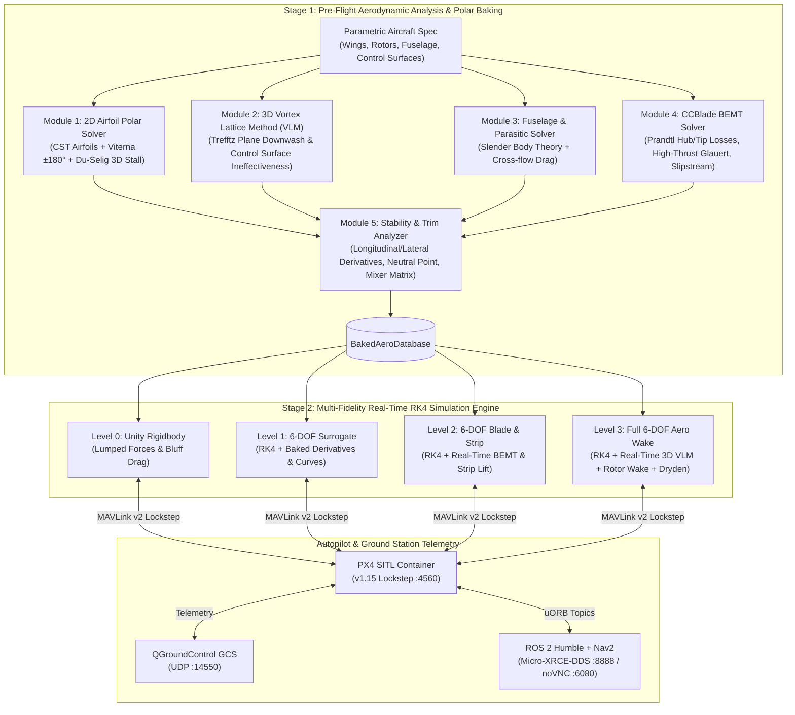

# FlightDynamics 6-DOF: Nonlinear UAV & eVTOL Flight Dynamics Suite for Unity 6

[](LICENSE)
[](https://unity.com/)
[](https://dotnet.microsoft.com/)
[](https://px4.io/)
[](https://www.ros.org/)
[](dotnet/FlightDynamics6DoF.Tests/)

**FlightDynamics 6-DOF** is a high-fidelity aerospace flight dynamics and simulation engineering suite for Unity. It combines offline aerodynamic polar generation (CST parametric airfoils, 3D Vortex Lattice Method, and CCBlade BEMT) with real-time multi-fidelity 6-DOF RK4 integration, zero-dependency MAVLink v2 lockstep communication, and a lightweight containerized PX4 Autopilot SITL stack optimized for macOS (Apple Silicon / Intel).

---

## Key Highlights

- **Multi-Fidelity 6-DOF Physics (Levels 0..3)**:
  - **Level 0**: Lightweight Unity `Rigidbody` coupled with lumped $K_t / K_q$ rotor thrust and bluff body drag.
  - **Level 1**: RK4 6-DOF simulation with pre-baked aerodynamic stability derivatives and surrogate BEMT curves.
  - **Level 2**: Strip-theory nonlinear lifting line solver with blade element rotor inflow dynamics.
  - **Level 3**: Full unsteady 3D Vortex Lattice Method (VLM) wake induction, rotor-slipstream wing impingement, and MIL-F-8785C Dryden turbulence.
- **Runway Ground Dynamics & Landing Gear Model**:
  - Coulomb rolling friction ($\mu_{\text{roll}} \approx 0.025$) for realistic fixed-wing runway acceleration.
  - Lateral tire cornering stiffness, nose-gear rotation freedom ($V_{\text{rot}}$), and automatic idle parking brake.
  - Surface boundary layer turbulence attenuation preventing parked airframe drift.
- **Zero-Dependency MAVLink v2 Lockstep & QGC Integration**:
  - Direct hardware-in-the-loop (HIL) lockstep (`HIL_SENSOR`, `HIL_ACTUATOR_CONTROLS`) over TCP port `4560`, bridged via a C++17 MAVLink standby proxy (`unity_mavlink_standby_proxy`) so upstream PX4-Autopilot stays unmodified.
  - True dynamic pressure ($\frac{1}{2}\rho V^2$) airspeed telemetry for PX4 EKF2 wind estimation and TECS fixed-wing controllers.
  - Independent UDP telemetry stream (`UDP :14550`) for simultaneous QGroundControl mission monitoring.
- **Unified 6-Step Engineering Workbench & Containerized macOS SITL Stack**:
  - Native container management via Colima (`containerd` + `vz` + `virtiofs`) and Apple `container` CLI.
  - Unified 6-step Editor Workbench (`FlightDynamicsEngineeringWizard`) with modular English panels (`AeroDesignPanel`, `InfraControlPanel`, `SimulationEnvironmentPanel`, `Px4TuningPanel`, `TelemetryLogPanel`, `Ros2Nav2Panel`) and `SitlInfraController` for real-time VM/container status badges, 1-click SITL startup, PX4 parameter tuning, live telemetry plotting (`Assets/FlightLogs/` + `FlightLogSettingsWindow`), and ROS 2/Nav2 control.
- **ROS 2 Humble, Micro-XRCE-DDS & Nav2 Obstacle Avoidance**:
  - Native uORB topic bridging over UDP port `8888` (`/fmu/in/*` and `/fmu/out/*`).
  - Pre-configured Python offboard trajectory controller for autonomous mission execution.
  - Integrated **Nav2 + RViz2 (`noVNC :6080`)** autonomous obstacle avoidance pipeline with Unity 2D Raycast LiDAR (`Ros2LidarAndObstacleCourse`, `UDP :8890`) and `unity_nav2_px4_bridge.py`.
- **Clean-Room Engineering & Permissive Licensing**:
  - 100% free of GPL/LGPL contamination. Pure Apache 2.0 license.

---

## System Architecture

FlightDynamics separates **Stage 1 (Pre-Simulation Aerodynamic Analysis)** from **Stage 2 (Real-Time 6-DOF Simulation)**:



---

## Supported Vehicle Configurations

| Vehicle Category | PX4 Model Flag | Mass (kg) | Wingspan | Propulsion Setup | Takeoff Mode | Actuator Mapping |
| :--- | :--- | :--- | :--- | :--- | :--- | :--- |
| **Multicopter (X)** | `iris` | 1.65 kg | — (0.45 m diag) | 4× Brushless Motors (Quad X) | Vertical VTOL | Ch 1..4: Motors |
| **Fixed-Wing UAV** | `plane` | 3.20 kg | 1.80 m | 1× Forward Tractor Propeller + Aileron/Elev/Rud | Runway Ground Roll | PX4 Ch 5: Throttle, Ch 6..9: Ail/Elev/Rud (Ch 1..4 fallback) |
| **QuadPlane VTOL** | `standard_vtol`| 5.40 kg | 1.80 m | 4× VTOL Lift Rotors + 1× Cruise Propeller + Surfaces | Hybrid VTOL & Cruise | Ch 1..4: VTOL, Ch 5: Cruise Prop, Ch 6..9: Surfaces |

---

## Quickstart Guide

### 1. Prerequisites
- **Operating System**: macOS (Apple Silicon M1/M2/M3/M4 or Intel) or Linux.
- **Unity**: Unity 6 (`6000.3.11f1` or newer) with .NET Standard 2.1 runtime.
- **Container Runtime**: [Colima](https://github.com/abiosoft/colima) with `containerd` runtime, or Apple `container`.
- **.NET SDK**: .NET 8 or 9 SDK (for building the core dynamics assembly).

### 2. Build the Core Dynamics Engine
Verify all 235 automated assertions and build the managed assemblies:

```bash
git clone https://github.com/jyhuh/UnityDrone.git
cd UnityDrone
./scripts/build-and-package.sh
```

### 3. Launch PX4 SITL & Run in Unity

#### Option A: In-Editor Unified Engineering Workbench (Recommended)
1. Open the project in **Unity 6** and open `Tools > FlightDynamics 6-DOF > Unified 5-Step Engineering Workbench` (6-tab UI).
2. **Step 1 (`1. Aero/Design`)**: Choose your airframe (`iris` / `plane` / `standard_vtol`) and run Stage-1 aerodynamic baking.
3. **Step 2 (`2. Infra`)**: Click **`▶ Start All Infra`** to start Colima/Apple container runtime, `unity-ros2-dds`, and `unity-px4-sitl` while monitoring live status badges in the header.
4. **Steps 3–5 (`3. Environment` / `4. PX4 Tuning` / `5. Telemetry`)**: Click **`▶ Start Simulation`**, tune PX4 parameters or send `pxh>` commands, and inspect real-time telemetry plots & saved logs in `Assets/FlightLogs/`.
5. **Step 6 (`6. ROS2/Nav2`)** *(Optional)*: Enable `Ros2LidarAndObstacleCourse`, launch **Nav2 + RViz2**, and open `http://localhost:6080/vnc.html` to command autonomous obstacle avoidance, or open **QGroundControl** (`UDP :14550`) for mission monitoring.

#### Option B: Terminal CLI
```bash
# Start the SITL container (e.g. Fixed-Wing plane)
./scripts/px4-sitl.sh up plane

# Check container status
./scripts/px4-sitl.sh status

# Launch ROS 2 Nav2 + RViz2 (noVNC at http://localhost:6080/vnc.html)
./scripts/px4-sitl.sh ros2-nav2

# Stop containers after session
./scripts/px4-sitl.sh down

# Completely shutdown the background Colima VM
./scripts/px4-sitl.sh vm-stop
```

---

## Technical Documentation Suite

Comprehensive engineering guides, mathematical derivations, and setup manuals are available in the [`docs/`](docs/) directory (compatible with GitHub Wiki and GitHub Pages):

1. [**System Architecture & Multi-Fidelity Solvers**](docs/architecture.md) — Two-stage architecture, CST airfoil modeling, 3D VLM downwash, CCBlade BEMT, and fidelity level trade-offs.
2. [**Ground Contact, Runway Friction & Landing Gear Mechanics**](docs/ground-contact-model.md) — Coulomb rolling resistance, lateral tire grip, takeoff rotation dynamics ($V_{\text{rot}}$), and boundary-layer turbulence attenuation.
3. [**PX4-Autopilot SITL & Container Stack Setup (macOS)**](docs/px4-sitl-setup.md) — Colima containerd optimization, MAVLink lockstep over TCP, dynamic pressure airspeed streaming, and port routing.
4. [**Vehicle Configuration & Parameter Tuning**](docs/vehicle-configuration.md) — Vehicle geometry configuration, aerodynamic polar baking, and actuator channel fallback matrix.
5. [**ROS 2 Humble & Micro-XRCE-DDS Integration**](docs/ros2-integration.md) — DDS topic mapping, offboard trajectory streaming, Python autonomous orbit controller, and Nav2 + RViz2 (noVNC) obstacle avoidance.
6. [**Task & Roadmap Backlog**](docs/roadmap.md) — Feature backlog and verification checklist *(in Korean)*.

---

## Repository Structure

```
UnityDrone/
├── .github/                       # GitHub Issue & Pull Request Templates
├── Assets/                        # Unity Project Assets & Test Scenes
├── docker/
│   ├── px4-sitl/                  # PX4 v1.15 SITL Containerfile & Startup Scripts
│   └── ros2/                      # ROS 2 Humble & Micro-XRCE-DDS Workspace
├── docs/                          # GitHub Wiki-compatible Technical Documentation
│   ├── README.md                  # Documentation Index & Sitemap
│   ├── architecture.md            # Physics & Mathematical Architecture
│   ├── ground-contact-model.md    # Runway Friction & Rotation Dynamics
│   ├── px4-sitl-setup.md          # macOS Colima SITL Deployment Guide
│   ├── vehicle-configuration.md   # Vehicle Specs & Mixer Calibration
│   ├── ros2-integration.md        # ROS 2 Autonomy & uORB Topic Guide
│   └── roadmap.md                 # Feature Backlog & Verification Checklist (Korean)
├── dotnet/
│   ├── FlightDynamics6DoF.Core/   # Pure C# .NET Standard 2.1 Core Physics Engine
│   └── FlightDynamics6DoF.Tests/  # 235 Automated Unit & Dynamics Test Assertions
├── Packages/
│   └── com.aerospace.flightdynamics6dof/ # UPM Distribution Package
├── scripts/
│   ├── build-and-package.sh       # Unified Build, Verification & Packaging Script
│   └── px4-sitl.sh                # Container Lifecycle & Colima VM Manager
├── CONTRIBUTING.md                # Conventional Commits & Contribution Guidelines
├── CODE_OF_CONDUCT.md             # Contributor Covenant Code of Conduct
├── LICENSE                        # Apache License 2.0
├── NOTICE                         # Clean-Room Engineering Notice & Attributions
└── README.md                      # Project Overview & Quickstart Guide
```

---

## Community & Contributing

We welcome contributions from aerospace engineers, simulation developers, and roboticists. Please review our guidelines before opening a pull request:
- [**Contributing Guidelines**](CONTRIBUTING.md) — Conventional Commits format, branch naming, and automated test requirements.
- [**Code of Conduct**](CODE_OF_CONDUCT.md) — Contributor Covenant v2.1 standards.
- [**Issue Tracker**](https://github.com/jyhuh/UnityDrone/issues) — File bug reports or submit feature requests using our templates.

---

## License & Intellectual Property

This project is licensed under the **Apache License, Version 2.0**. See the [LICENSE](LICENSE) file for complete terms.

For detailed attribution of underlying academic literature (AirfoilPrep, CCBlade, NeuralFoil, FLOWUnsteady) and clean-room engineering confirmation, see [NOTICE](NOTICE).
