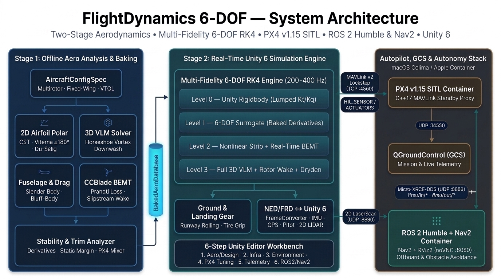
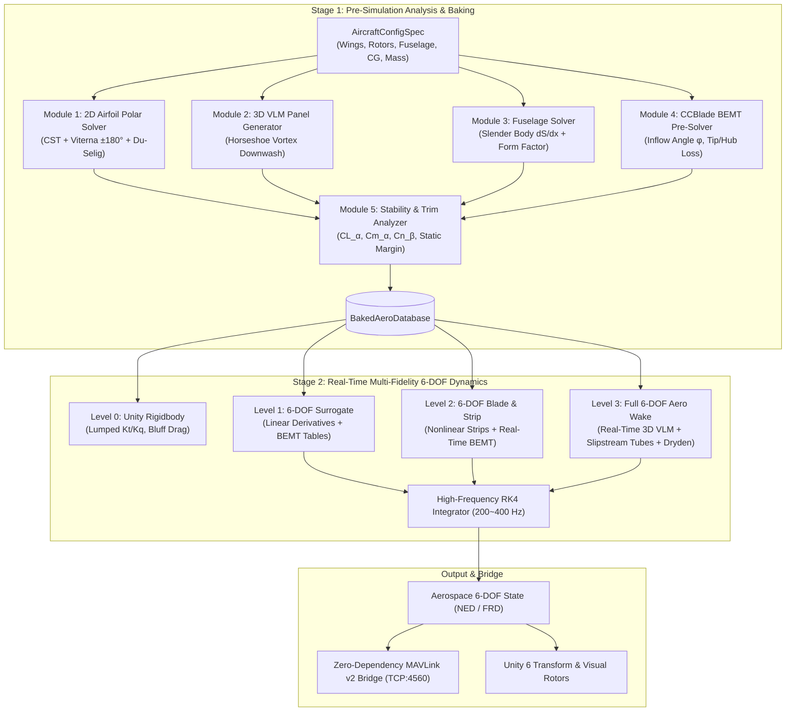

# System Architecture & Multi-Fidelity Aerodynamics

FlightDynamics 6-DOF is structured around a **Two-Stage Architecture** designed to balance physical fidelity against real-time 400 Hz numerical execution budgets.



<details>
<summary>View Mermaid diagram</summary>



</details>

---

## 1. Stage 1: Aerodynamic Analysis Modules

### Module 1: Airfoil Polar Modeling & Post-Stall Extrapolation
- **Parameterization**: Employs CST (Class-Shape Transformation) polynomial equations representing airfoil thickness and camber with 8 parameters.
- **Viscous Solver**: Low/medium alpha lift, drag, and moment polars ($C_l, C_d, C_m$) calculated across Reynolds numbers $10^4 \le Re \le 10^7$ and Mach numbers $M < 0.7$.
- **Viterna Post-Stall Extrapolation**: High angles of attack ($|\alpha| > 20^\circ$ up to $\pm 180^\circ$) transition to 2D flat-plate Kirchhoff/Viterna formulations to prevent unphysical numerical discontinuities during stall and spin.
- **Du-Selig 3D Rotational Stall Delay**: Corrects blade profile polars based on local rotational speed $\Omega r / V_{\infty}$ and chord-to-radius ratio $c/r$.

### Module 2: 3D Lifting Surfaces (VLM & Strips)
- Wings, horizontal tailplanes, vertical fins, and canards are discretized into chordwise and spanwise panel elements.
- Quarter-chord bound horseshoe vortices model finite-wing 3D induced downwash.
- Control surfaces (ailerons, elevators, rudders, elevons, flaps) deflect local camber and zero-lift angle $\alpha_0$.

### Module 3: Fuselage Aerodynamics & Parasitic Drag
- **Slender Body Theory (Multhopp / Munk)**: Computes destabilizing pitching and yawing moments ($C_{m_{\alpha, \text{fus}}} > 0$, $C_{n_{\beta, \text{fus}}} < 0$) from axial cross-sectional area distribution $S(x)$.
- **Component Build-up Drag ($C_{D_0}$)**: Turbulent skin friction ($C_f$), form factor ($FF$), wetted area ($S_{\text{wet}}$), and interference factors ($Q$).
- **Cross-Flow Drag**: Bluff-body transverse drag formulation for multirotors and high-sideslip attitudes.

### Module 4: CCBlade Rotor Dynamics & Wake Interaction
- Formulates Blade Element Momentum Theory (BEMT) around local inflow angle $\phi$, eliminating numerical singularities near axial zero-thrust.
- Prandtl tip-loss and hub-loss factor $F = F_{\text{tip}} \cdot F_{\text{hub}}$.
- Glauert-Buhl correction in high-induction turbulent wake states ($a > 0.4$).
- Calculates expanding/contracting slipstream tube velocity fields:
  $$r(x) = R \sqrt{\frac{1 + a}{1 + a [1 + x / \sqrt{R^2 + x^2}]}}$$
  inducing blown-wing lift and control authority over control surfaces during hover-to-forward flight transitions.

### Module 5: Stability Derivatives, Static Margin & Control Mixer
- Automatically perturbs state variables ($\alpha, \beta, p, q, r, \delta_a, \delta_e, \delta_r$) to evaluate non-dimensional stability derivatives:
  - Longitudinal: $C_{L_\alpha}, C_{D_0}, C_{m_\alpha}, C_{m_q}, C_{m_{\delta_e}}$
  - Lateral-Directional: $C_{Y_\beta}, C_{l_\beta}, C_{n_\beta}, C_{l_p}, C_{n_r}, C_{l_{\delta_a}}, C_{n_{\delta_r}}$
- Computes aerodynamic center, neutral point $x_{\text{NP}}$, and static margin ($SM = \frac{x_{\text{NP}} - x_{\text{CG}}}{\bar{c}}$).
- Synthesizes control allocation pseudo-inverse mixing matrix and exports PX4 v1.14+ `CA_ROTOR*` / `CA_SV_CS*` parameters.

---

## 2. Stage 2: Real-Time Multi-Fidelity Simulation Levels

| Fidelity Level | Dynamics Engine | Aerodynamic Method | Rotor Method | Target Use Case |
| :--- | :--- | :--- | :--- | :--- |
| **Level 0** | Unity Rigidbody (PhysX) | Lumped parasitic drag & bluff body | Stage-1 lumped $K_T \omega^2, K_Q \omega^2$ | Rapid prototyping, casual flight gameplay |
| **Level 1** | Pure C# RK4 (400 Hz) | Linear stability derivative expansion | Pre-baked rotor thrust & power curves | High-volume swarm simulation, ML training |
| **Level 2** | Pure C# RK4 (400 Hz) | Nonlinear lifting-line strip solver | Real-time CCBlade BEMT solver | Precision UAV dynamics & GNC validation |
| **Level 3** | Pure C# RK4 (400 Hz) | 3D VLM horseshoe vortex wake | CCBlade BEMT + Slipstream wake coupling | Hardware-in-the-Loop (HIL) transition flight |

---

## 3. Coordinate System Invariance

Aerospace calculations strictly use **North-East-Down (NED)** inertial and **Forward-Right-Down (FRD)** body frames. Conversions to Unity's Left-Handed (`+X` Right, `+Y` Up, `+Z` Forward) coordinate system pass through `FrameConverter`:

```csharp
// Lossless Coordinate Mapping
Vec3d nedPos = FrameConverter.UnityToNedPosition(unityPos);
Quatd nedRot = FrameConverter.UnityToNedRotation(unityRot);
Vector3 unityPos = FrameConverter.NedToUnityPosition(nedPos);
```
