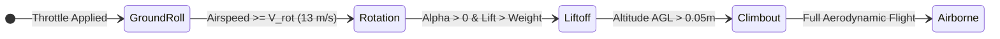

# Ground Contact, Runway Friction & Landing Gear Mechanics

Aerospace vehicles transition across distinct operating regimes: disarmed/idle rest on the apron, high-speed ground roll during takeoff and landing runs, and free airborne flight. Traditional simulation approaches frequently suffer from two common failure modes:
1. **Excessive Viscous Drag**: Modeling ground friction as simple linear velocity damping ($-c \cdot v_x$) produces tens of Newtons of artificial braking at moderate speeds, completely stalling takeoff acceleration.
2. **Ground Sliding & Creep**: Lack of static friction or boundary-layer wind attenuation causes light UAVs to slide uncontrollably across the runway when sitting idle in ambient crosswinds.

FlightDynamics 6-DOF implements a physically consistent, unified ground interaction model featuring Coulomb rolling friction, lateral tire cornering stiffness, landing gear pitch rotation constraints, parking brake logic, and surface boundary layer turbulence attenuation.

---

## 1. Penetration Depth & Normal Reaction Force

Ground contact is evaluated relative to the local runway elevation in the aerospace North-East-Down (NED) frame:

$$\text{depth} = z_{\text{NED}} - z_{\text{ground}}$$

When the vehicle penetrates the runway plane ($\text{depth} > 0$), a compliant spring-damper contact force is generated along the vertical axis:

$$k_{\text{spring}} = 120.0 \cdot m \quad [\text{N/m}]$$
$$c_{\text{damper}} = 22.0 \cdot m \quad [\text{N/(m/s)}]$$
$$N = \max\left(0,\, k_{\text{spring}} \cdot \text{depth} + c_{\text{damper}} \cdot \max(0, v_{z, \text{NED}})\right)$$

- When airborne ($\text{depth} \le 0$), normal force $N = 0$.
- Downward velocity penetration ($v_{z, \text{NED}} > 0$) is damped to prevent restitution oscillations.
- Geometric hard clamping ensures $z_{\text{NED}} \le z_{\text{ground}}$, resetting vertical velocity to zero upon penetration correction.

---

## 2. Wheeled Runway Rolling Resistance (Takeoff Roll)

For wheeled airframes (Fixed-Wing and QuadPlane VTOL in forward flight):

### Coulomb Rolling Friction Formulation
On paved asphalt or concrete runways, rolling resistance is governed by the rolling friction coefficient $\mu_{\text{roll}} \approx 0.025$:

$$F_{\text{roll}} = \mu_{\text{roll}} \cdot N$$

To avoid numerical singularity at zero ground speed, friction directionality is smoothed using a hyperbolic tangent transition:

$$F_{x, \text{NED}} = -F_{\text{roll}} \cdot \tanh(3.0 \cdot v_{x, \text{NED}})$$

### Linear Damping vs. Coulomb Rolling Resistance Comparison

| Metric | Linear Damper Model (Flawed) | FlightDynamics Coulomb Model (Current) |
| :--- | :--- | :--- |
| **Equation** | $F_x = -c_{\text{damper}} \cdot 0.25 \cdot v_x$ | $F_x = -\mu_{\text{roll}} N \cdot \tanh(3.0 v_x)$ |
| **Resistance at 2 m/s** | $\approx 17.6\text{ N}$ | $\approx 0.78\text{ N}$ |
| **Resistance at 15 m/s** | $\approx 132.0\text{ N}$ | $\approx 0.78\text{ N}$ |
| **Takeoff Outcome** | **STALLED** (Engine thrust $\approx 18\text{ N}$ cannot overcome drag) | **SUCCESS** (Accelerates to 19.6 m/s in 3.0 s) |

---

## 3. Lateral Tire Grip & Directional Stabilization

During ground roll, tricycle or taildragger landing gear generates cornering forces that resist sideslip ($v_y$) and maintain runway centerline tracking:

$$F_{y, \text{max}} = 0.7 \cdot N \quad (\mu_{\text{lateral}} \approx 0.7)$$
$$F_{y, \text{NED}} = -\operatorname{clamp}\left(-F_{y, \text{max}},\, F_{y, \text{max}},\, 0.5 \cdot c_{\text{damper}} \cdot v_{y, \text{NED}}\right)$$

### Landing Gear Restoring Moments
Tricycle landing gear geometry naturally provides passive roll and yaw alignment damping:

$$\mathbf{M}_{\text{contact}} = \begin{bmatrix} -2.5 \cdot m \cdot \omega_x \\ -0.3 \cdot m \cdot \omega_y \\ -2.0 \cdot m \cdot \omega_z \end{bmatrix}_{\text{FRD}}$$

This stabilizes wing rock ($\omega_x$) and ground loops ($\omega_z$) without locking pilot rudder steering.

---

## 4. Pitch Attitude Constraints & Takeoff Rotation ($V_{\text{rot}}$)

In aerospace body FRD coordinates:
- Pitch angle $\theta > 0$ corresponds to **nose-down**.
- Pitch angle $\theta < 0$ corresponds to **nose-up** (climb attitude).



### Nose Gear Clearance vs. Rotation Freedom
1. **Nose Gear Ground Floor ($\theta > 0.015\text{ rad}$)**:
   The nose wheel prevents the aircraft fuselage from pitching downward into the runway. If $\theta > 0.015$ and pitch rate $\omega_y > 0$ (pitching further down), $\omega_y$ is clamped to 0.
2. **Unconstrained Takeoff Rotation ($\theta < 0$)**:
   The elevator control surface creates nose-up pitch moment ($\omega_y < 0$), rotating the airframe onto the main gear to increase wing angle of attack $\alpha$. As airspeed exceeds $V_{\text{rot}} \approx 13\text{ m/s}$, lift exceeds total weight, seamlessly breaking ground contact.

---

## 5. Parking Brake & Idle Ground Hold

When an aircraft is resting on the runway with net downward load ($N > 0$) and motor throttle is at idle ($< 5\%$):

$$v_{x, \text{NED}} \leftarrow v_{x, \text{NED}} \cdot \max(0, 1 - 25.0 \cdot \Delta t)$$
$$v_{y, \text{NED}} \leftarrow v_{y, \text{NED}} \cdot \max(0, 1 - 25.0 \cdot \Delta t)$$
$$\boldsymbol{\omega}_{\text{body}} \leftarrow \boldsymbol{\omega}_{\text{body}} \cdot \max(0, 1 - 25.0 \cdot \Delta t)$$

This acts as a pneumatic parking brake, ensuring that parked or disarmed UAVs remain stationary even under gusty atmospheric conditions.

---

## 6. Surface Boundary Layer Gust Attenuation

Physical atmospheric boundary layer friction quenches turbulent velocity fluctuations at the ground surface. FlightDynamics models this via a linear height attenuation factor in the Dryden gust generator:

$$\gamma_{\text{ground}} = \operatorname{clamp}\left(\frac{h_{\text{AGL}} - 0.05}{1.5},\, 0.0,\, 1.0\right)$$

$$\sigma_{w, \text{effective}} = \sigma_{w, \text{nominal}} \cdot \gamma_{\text{ground}}$$

- **$h_{\text{AGL}} \le 0.05\text{ m}$**: Turbulence is strictly zeroed. The resting airframe experiences zero stochastic gust shaking.
- **$0.05\text{ m} < h_{\text{AGL}} \le 1.55\text{ m}$**: Turbulence smoothly scales from 0% to 100%.
- **$h_{\text{AGL}} > 1.55\text{ m}$**: Full Dryden turbulence operates unattenuated.

---

## Verification & Test Assertions

Run the automated test suite to verify rolling resistance and liftoff dynamics:

```bash
./scripts/build-and-package.sh
```

Key test cases in `MultiFidelityEngineTests.cs`:
- `FixedWing_TakeoffAcceleration_AcceleratesAboveTakeoffSpeed`: Verifies rolling speed $> 18\text{ m/s}$ in $< 3.0\text{ s}$ with ground roll distance $< 35\text{ m}$.
- `FixedWing_LiftoffRotation_AchievesPositiveAltitude`: Verifies elevator rotation produces positive AGL climbout without ground snag.
- `RestingAirframe_ZeroThrottle_RemainsStationaryInWind`: Verifies zero drift when parking brake is active.
