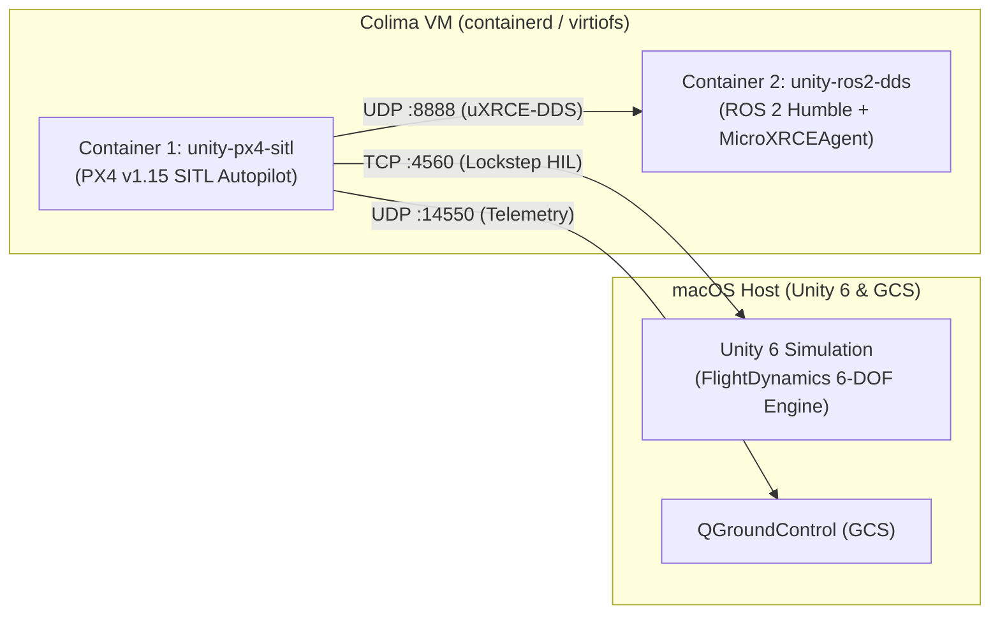

# PX4-Autopilot SITL & Container Stack Setup (macOS)

FlightDynamics 6-DOF runs a complete **PX4-Autopilot v1.15.0 SITL** stack alongside **ROS 2 Humble** on macOS Apple Silicon (M1/M2/M3/M4) without requiring Docker Desktop, using lightweight non-Docker container runtimes.

---

## 1. Architecture & Port Mapping



### Network Communication Ports
| Protocol / Port | Direction | Source $\to$ Destination | Description |
| :--- | :--- | :--- | :--- |
| **TCP 4560** | Bidirectional | `unity-px4-sitl` $\to$ macOS Unity | Lockstep MAVLink HIL protocol (Sensors & Actuator controls) via C++ standby proxy (`127.0.0.1:14560` $\leftrightarrow$ `host:4560`) |
| **UDP 14550** | Outbound | `unity-px4-sitl` $\to$ macOS QGC | Standard MAVLink telemetry stream for QGroundControl |
| **UDP 8888** | Local VM | `unity-px4-sitl` $\to$ `unity-ros2-dds` | Micro-XRCE-DDS client-agent bridge for uORB $\leftrightarrow$ ROS 2 topics |

> **C++17 MAVLink Standby Proxy (`unity_mavlink_standby_proxy`)**: PX4-Autopilot runs unmodified upstream by connecting to `127.0.0.1:14560` inside the container. When Unity is not in Play Mode, the proxy feeds 250 Hz standby `HIL_SENSOR` / `HIL_GPS` frames with monotonic timestamps and sea-level-consistent pressure (`1007.26 hPa` at `50 m` MSL) so EKF2 and QGC stay alive; once Unity Play Mode opens `:4560`, it seamlessly bridges Unity's live sensor stream to PX4.

---

## 2. Prerequisites & Installation

### Option A: Colima (Recommended for macOS)
Colima runs an aarch64 Linux micro-VM using Apple's native `Virtualization.framework` (`vz`) and `virtiofs` directory sharing:

```bash
# 1. Install Colima and containerd tooling via Homebrew
brew install colima nerdctl

# 2. Setup container stack (automatically compiles PX4 SITL Linux binary inside container)
CONTAINER_BACKEND=colima ./scripts/px4-sitl.sh setup
```

### Option B: Apple `container` CLI
If using Apple's experimental native micro-VM container manager ([github.com/apple/container](https://github.com/apple/container)):

```bash
brew install --cask container
CONTAINER_BACKEND=apple ./scripts/px4-sitl.sh setup
```

---

## 3. Container Lifecycle Commands

Manage the SITL stack from your terminal:

```bash
# Start containers for Multirotor (iris)
./scripts/px4-sitl.sh up iris

# Start containers for Fixed-Wing (plane)
./scripts/px4-sitl.sh up plane

# Start containers for Hybrid QuadPlane VTOL (standard_vtol)
./scripts/px4-sitl.sh up standard_vtol

# Stop active containers (keeps Colima VM warm for rapid restarts)
./scripts/px4-sitl.sh down

# Completely shut down containers AND stop the Colima VM (reclaims Mac RAM/CPU)
./scripts/px4-sitl.sh vm-stop

# Tail live logs from PX4 SITL
./scripts/px4-sitl.sh logs

# Send interactive command to PX4 NuttX shell (pxh)
./scripts/px4-sitl.sh pxh commander takeoff
./scripts/px4-sitl.sh pxh commander land

# Launch ROS 2 Nav2 + RViz2 (noVNC at http://localhost:6080/vnc.html)
./scripts/px4-sitl.sh ros2-nav2
```

---

## 4. Unity Editor Workbench Controls

You can control all container, PX4, ROS 2/Nav2, and simulation actions directly inside the Unity Editor without opening a terminal:

1. Open **`Tools > FlightDynamics 6-DOF > Unified 5-Step Engineering Workbench`** (`FlightDynamicsEngineeringWizard`, 6-tab UI).
2. Check the live status strip at the top (`VM`, `containerd`, `unity-px4-sitl`, `unity-ros2-dds`, and `Simulation`), updated asynchronously by `SitlInfraController`.
3. In **Step 2 (`2. Infra`)**:
   - **`▶ Start All Infra (<model>)`**: Starts the Colima/Apple container runtime, `unity-ros2-dds`, and `unity-px4-sitl` with the selected airframe (`iris`, `plane`, or `standard_vtol`).
   - **`■ Stop All (Shutdown VM)`**: Stops PX4/ROS 2 containers and shuts down the Colima VM (`vm-stop`).
   - **Advanced Foldout**: Individual PX4/ROS 2 start/stop, `Stop Containers Only (down)`, `rootfs_*` cache reset, `Check VM/containerd`, `Repair containerd`, `Start Colima VM`, and `View Logs in Terminal`.
4. In **Step 4 (`4. PX4 Tuning`)**:
   - **`pxh>` Input Field & Quick Buttons**: Send `commander arm`, `takeoff`, `land`, `vtol_transition`, or custom NuttX shell commands.
5. In **Step 6 (`6. ROS2/Nav2`)**:
   - Configure `Ros2LidarAndObstacleCourse` (2D Raycast LiDAR + test obstacles), start/stop **Nav2 + RViz2**, open **`http://localhost:6080/vnc.html`**, or run the built-in circular Offboard node.

---

## 5. MAVLink Sensor Feedback & Pitot Airspeed Streaming

To support fixed-wing runway acceleration, rotation, and climbout, `VirtualSensorSuite` computes real-time dynamic pressure ($q$):
$$q = \frac{1}{2} \rho V_{\text{ias}}^2 \quad [\text{Pa}]$$
and streams it inside `HIL_SENSOR.diff_pressure` (in millibar/hPa, offset 48).

Without this sensor stream, PX4's EKF2 and fixed-wing TECS position controller assume zero airspeed and will refuse to rotate elevator control surfaces on the runway. FlightDynamics 6-DOF provides accurate differential pressure at 200 Hz.
