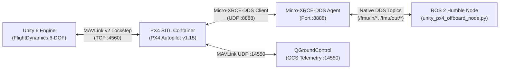

# ROS 2 Humble & Micro-XRCE-DDS Integration

PX4 Autopilot integrates with modern robotics middleware through the **Micro-XRCE-DDS** client-agent bridge. This architecture maps PX4's internal uORB publish-subscribe messaging directly into **ROS 2 Humble** topics without requiring heavy MAVROS translation layers.

FlightDynamics 6-DOF provides a containerized ROS 2 workspace ready for offboard mission planning, perception pipelines, and autonomous trajectory control.

---

## Architecture Overview



---

## 1. Prerequisites & Container Environment

The ROS 2 stack is orchestrated via Apple `container` CLI or `colima` with standard Docker compose files located in `docker/`:

- **PX4 SITL Image**: Includes PX4 v1.15 with the built-in `uxrce_dds_client`.
- **ROS 2 Container Image**: Ubuntu 22.04 with ROS 2 Humble, `px4_msgs` pre-compiled, and Micro-XRCE-DDS Agent.

### Starting the Stack

```bash
# 1. Start PX4 SITL container
./scripts/px4-sitl.sh up plane

# 2. Start the ROS 2 Offboard container
./scripts/px4-sitl.sh ros2-up
```

Verify active containers:
```bash
colima -p flightdynamics status
docker ps
```

---

## 2. Topic Mapping Matrix

PX4 uORB topics are exposed under the `/fmu/` namespace. 

> [!IMPORTANT]
> All publishers communicating with PX4 must use **Best Effort** reliability QoS with a history depth of 1, matching PX4's internal real-time DDS configuration.

### Inbound Topics (ROS 2 -> PX4)

| ROS 2 Topic | Message Type | Function |
| :--- | :--- | :--- |
| `/fmu/in/offboard_control_mode` | `px4_msgs/msg/OffboardControlMode` | Heartbeat signaling which setpoints are actively controlled (position, velocity, attitude). Must be sent at $\ge 2\text{ Hz}$. |
| `/fmu/in/trajectory_setpoint` | `px4_msgs/msg/TrajectorySetpoint` | Target position (NED), velocity, or acceleration setpoints. |
| `/fmu/in/vehicle_command` | `px4_msgs/msg/VehicleCommand` | MAVLink command injection (arming, flight mode switching, VTOL transition). |

### Outbound Topics (PX4 -> ROS 2)

| ROS 2 Topic | Message Type | Function |
| :--- | :--- | :--- |
| `/fmu/out/vehicle_local_position` | `px4_msgs/msg/VehicleLocalPosition` | Local position $(x, y, z)$ in NED frame, velocity, and heading. |
| `/fmu/out/vehicle_status` | `px4_msgs/msg/VehicleStatus` | Current arming state, navigation state, and failsafe flags. |
| `/fmu/out/vehicle_odometry` | `px4_msgs/msg/VehicleOdometry` | Full state estimate with covariance from EKF2. |

---

## 3. Offboard Control Implementation (`unity_px4_offboard_node.py`)

A reference implementation for autonomous arming, takeoff, and trajectory tracking is located at:
[docker/ros2/unity_px4_offboard_node.py](file:///Users/byabya/UnityDrone/docker/ros2/unity_px4_offboard_node.py)

### Step 1: Setting up the Heartbeat Loop
PX4 will refuse to enter or maintain **Offboard Mode** unless it receives an active heartbeat stream:

```python
from px4_msgs.msg import OffboardControlMode, TrajectorySetpoint
from rclpy.qos import QoSProfile, ReliabilityPolicy, HistoryPolicy, DurabilityPolicy

qos = QoSProfile(
    reliability=ReliabilityPolicy.BEST_EFFORT,
    durability=DurabilityPolicy.TRANSIENT_LOCAL,
    history=HistoryPolicy.KEEP_LAST,
    depth=1,
)

# Publish heartbeat at 20 Hz (well above PX4's 2 Hz timeout limit)
mode_msg = OffboardControlMode()
mode_msg.timestamp = now_us
mode_msg.position = True
mode_msg.velocity = False
mode_msg.acceleration = False
self.offboard_mode_pub.publish(mode_msg)
```

### Step 2: Commanding Arming & Mode Switch
Once at least 10 heartbeat messages have been sent, the node commands arming and flight mode switch via `VehicleCommand`:

```python
# Arm Vehicle (VehicleCommand.VEHICLE_CMD_COMPONENT_ARM_DISARM = 400)
self._publish_vehicle_command(command=400, param1=1.0)

# Switch to Offboard (VehicleCommand.VEHICLE_CMD_DO_SET_MODE = 176, custom_mode=6)
self._publish_vehicle_command(command=176, param1=1.0, param2=6.0)
```

### Step 3: Circular Orbit Trajectory
During flight, the node calculates a 3D circular orbit in the NED coordinate frame:

$$x_{\text{target}} = R \cdot \cos(\omega t)$$
$$y_{\text{target}} = R \cdot \sin(\omega t)$$
$$z_{\text{target}} = -h_{\text{altitude}}$$

```python
sp = TrajectorySetpoint()
sp.timestamp = now_us
sp.position = [target_x, target_y, -abs(target_altitude)]
sp.yaw = math.atan2(target_y, target_x) + math.pi / 2.0  # Tangent heading
self.trajectory_pub.publish(sp)
```

---

## 4. Running the Example Node

Inside the running ROS 2 container:

```bash
# Enter the ROS 2 container shell
docker exec -it flightdynamics-ros2 bash

# Source the workspace
source /opt/ros/humble/setup.bash
source /ros2_ws/install/setup.bash

# Verify active topics from PX4
ros2 topic list

# Launch the autonomous circular orbit mission
python3 /ros2_ws/unity_px4_offboard_node.py --altitude 15.0 --radius 12.0
```

---

## 5. Key Pitfalls & Best Practices

1. **NED Coordinate Frame**:
   PX4 uses **North-East-Down**. Altitude is represented as a **negative Z** value ($z = -15.0\text{ m}$ means 15 meters above ground). Positive Z represents penetration below ground.
2. **Heartbeat Stream Before Mode Switch**:
   Never send the command to switch to Offboard mode before streaming setpoints and heartbeats for at least 0.5 seconds. PX4 will reject the mode change command otherwise.
3. **QoS Profile Mismatch**:
   If `ros2 topic echo /fmu/out/vehicle_status` shows no output, verify that your subscriber QoS uses `ReliabilityPolicy.BEST_EFFORT`. Using default ROS 2 `RELIABLE` QoS will prevent connection to Micro-XRCE-DDS topics.
